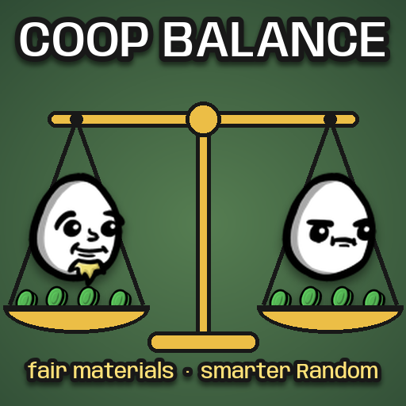

<p align="center"></p>

# Coop Balance for Brotato

A small mod that makes Brotato co-op fairer.

- **Fair materials.** In vanilla co-op, if one player picks a character with
  a materials malus, the partner loses materials too. This mod fixes that.
- **Smarter Random button.** The Random character button no longer picks
  characters that make co-op much harder, or characters you've already beaten
  Nightmare with on that map.

**Install:** [Steam Workshop page](https://steamcommunity.com/sharedfiles/filedetails/?id=3839050939)
(subscribe and restart the game).
**Game version:** Brotato 1.2.0.3 (ModLoader 6.3).

---

## 1. Fair materials in co-op

### The problem

In co-op, Brotato does not apply each character's materials modifier to its
own player. It **averages** the modifiers of all players, then splits every
material that is picked up evenly between the players.

So if player 1 picks **Farmer** (-50 % materials) and player 2 picks a
character with no malus, both players end up at **-25 %**. Player 2 pays half
of a drawback they never chose.

The same thing happens with every character that has a materials malus:

| Malus | Characters |
|---|---|
| -% materials (all sources) | Farmer -50 %, Streamer -50 %, Hiker -50 %, Survivor -25 % |
| -% materials dropped by enemies | Explorer -50 %, Cryptid -50 %, Archaeologist -50 %, Buccaneer -50 %, Fisherman -40 % |

### What the mod does

After every pickup, the mod tops up each player so that **nobody suffers more
than their own malus**:

| | Player 1 (Farmer) | Player 2 (no malus) |
|---|---|---|
| Vanilla | 75 % | 75 % |
| With Coop Balance | 75 % (unchanged) | **100 %** |

- The player carrying the malus keeps the vanilla result. The mod never takes
  anything away from anybody.
- Bonuses stay shared like in vanilla (Jack's +200 % materials still helps
  both players).
- Two Farmers stay at -50 %: there is nothing unfair to fix.
- The extra materials also give the matching XP, like a normal pickup.
- The compensation is computed from the real in-game effects, not from a
  character list, so items that change materials drops are handled too.
- No effect in solo.

Rule used for each player:
`mean(bonuses of all players) + max(mean(maluses), own malus)`.

### In-game overlay

During co-op waves, a small block at the top of the screen (right of the wave
timer) shows the extra materials each player receives, for enemy drops and for
tree drops, e.g. `enemies  P1 +0%  P2 +33%`.

## 2. Smarter Random character button

The Random button draws a character for you. The mod removes two kinds of
characters from that draw. They all stay selectable manually.

**Characters that make co-op much harder (co-op only).** Some characters
buff the enemies for both players. A random draw shouldn't force that on
your partner:

| Excluded | Why |
|---|---|
| Jack | +175 % enemy health, +35 % enemy damage |
| Diver | +200 % enemy health |
| Chef | +100 % enemy health |

Curious (+25 % enemy health), Captain (+2 % enemy health and damage per
wave) and Droid (+5 % enemy damage per level) only add a small buff, so they
stay in the draw.

**Characters that already beat Nightmare on the selected map (solo and
co-op).** Random is a good way to discover characters, so the mod skips the
ones you've already beaten Nightmare (danger 6) with on that map. When the map
is set to Random, a character is skipped only if it beat Nightmare on every
map.

If a filter would leave no character to draw from, it is ignored for that
draw.

## Configuration

Settings are in
[`mods-unpacked/BrotatoCoop-CoopBalance/config.gd`](mods-unpacked/BrotatoCoop-CoopBalance/config.gd)
(rebuild the zip after editing):

| Setting | Default | Meaning |
|---|---|---|
| `ENABLE_GOLD_COMPENSATION` | `true` | Fair materials in co-op |
| `STRICT_OWN_MALUS` | `false` | `true`: each player fully suffers their own malus (the malus carrier gets less than vanilla) |
| `SHOW_DEBUG_HUD` | `true` | Co-op overlay |
| `DEBUG_LOG` | `false` | Log every compensated pickup |
| `ENABLE_RANDOM_FILTER` | `true` | Skip enemy-buffing characters in co-op Random |
| `RANDOM_EXCLUDED_EFFECT_KEYS` | `enemy_health`, `enemy_damage` | Effects that get a character skipped |
| `RANDOM_EFFECT_FILTER_WHITELIST` | Droid, Captain, Curious | Characters kept despite such an effect |
| `RANDOM_EXCLUDE_BEATEN_DIFFICULTY` | `6` | Skip characters that beat this danger on the map (0 = off) |

## Install

**Steam Workshop (recommended):** subscribe on the
[Workshop page](https://steamcommunity.com/sharedfiles/filedetails/?id=3839050939)
and restart the game.

**Manual:** download `CoopBalance.zip` from the
[Releases](../../releases) page. The Steam version of Brotato only loads mods
from subscribed Workshop items, but it loads every zip it finds in such an
item's folder: put the zip in
`<Steam>/steamapps/workshop/content/1942280/<id of any subscribed mod>/`
and restart. Steam may delete it when that item updates.

To check that the mod loaded, look for `CoopBalance loaded` in
`%APPDATA%\Brotato\logs\modloader.log`.

## Compatibility

- Made for Brotato 1.2.0.3 with ModLoader 6.3.
- Extends `main.gd` (`get_gold_value`, `on_gold_picked_up`), the materials
  item (`drop`) and the character selection screen (`_on_element_pressed`).
  Other mods that extend the same functions should still work, as the mod
  always calls the original code.

## Known limits

- Materials left on the ground at the end of a wave (converted into bonus
  materials for the next wave) are not compensated.
- Not tested with more than 2 players, although the logic supports 4.

## Build from source

```powershell
powershell -ExecutionPolicy Bypass -File build.ps1
```

Produces `CoopBalance.zip`, with `mods-unpacked/BrotatoCoop-CoopBalance/`
at the root of the zip.

To push a new version to the Workshop item (needs Steam running and
ownership of the item), from the game folder:

```
GodotWorkshopUtility.exe --no-window -s <repo>/tools/workshop_upload.gd ^
  --ws-id=3839050939 --ws-zip=<repo>/CoopBalance.zip --ws-note="What changed"
```

Optional: `--ws-desc=<file>`, `--ws-title=<title>`, `--ws-preview=<image>`.

## License

MIT, see [LICENSE](LICENSE). Brotato is a trademark of Blobfish; this is an
unofficial fan mod. The icon uses art from the game.
